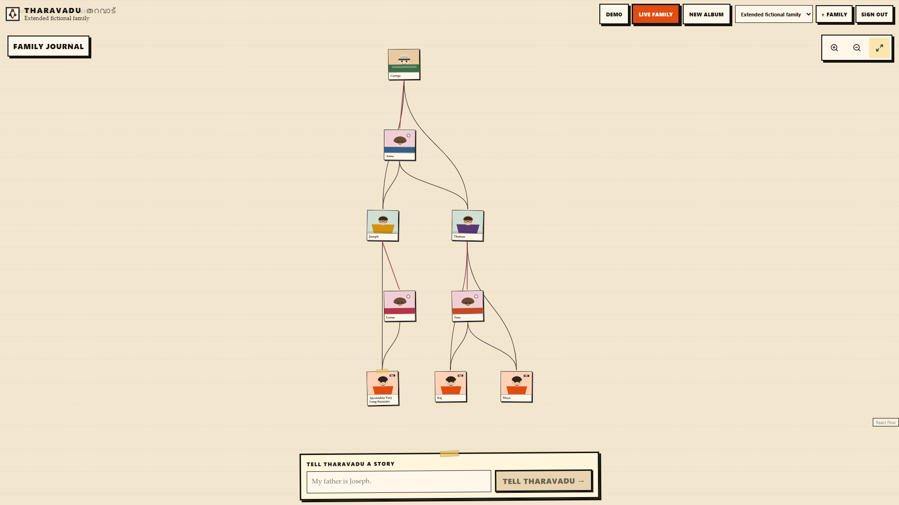
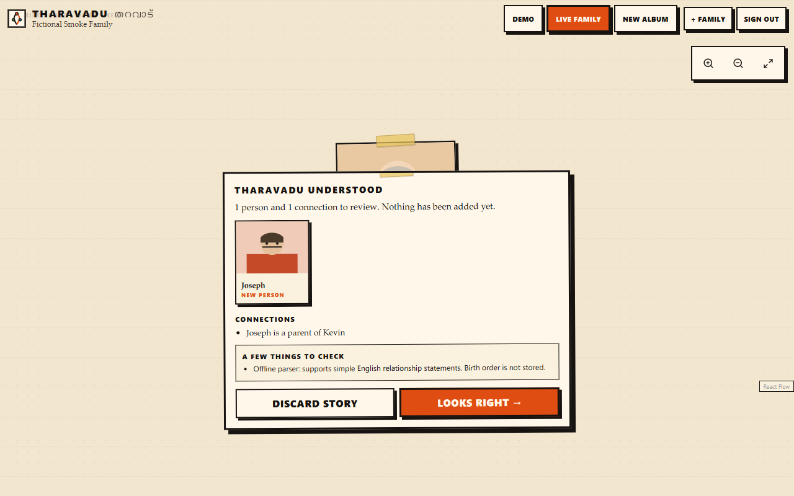

# Tharavadu (തറവാട്)

**A local-first family history workspace.** Tell a story, review the proposed people and connections, and choose what becomes part of your family tree. Tharavadu keeps kinship answers grounded in a deterministic Python graph, while its AI providers only interpret stories into proposals.





Family history is personal and often uncertain. Tharavadu gives people a visual place to preserve memories and correct mistakes without letting a language model silently decide family truth. The default setup uses SQLite, a local graph, and an offline English parser: no paid service, API key, Neo4j, or PostgreSQL is needed.

## What works today

- Register, sign in, create separate family workspaces, and return to persisted data.
- Add relatives through a narrative proposal, inspect the interpretation, resolve ambiguous names, then confirm or discard it.
- Explore the family canvas and ask for deterministic relationships with an evidence trail.
- Keep and remove journal memories linked to people. Edit people and remove relationships; in local mode, remove a person without recursively deleting relatives. Memories remain in the family journal with the removed person's link detached.
- Try a fictional demo family without creating an account.

The offline parser recognizes simple English relationship statements; it is not a general language model. An optional OpenAI provider can interpret broader stories, but still cannot write graph truth. The Neo4j adapter exists, but live Neo4j/PostgreSQL operation is not covered by the default test suite. Person deletion is currently unavailable in Neo4j mode; see [ADR-0004](docs/adr/ADR-0004-person-removal-memory-retention.md).

## Quick start

Use Python 3.12+, Node.js 22+, npm, and Git. From the repository root:

```bash
git clone https://github.com/KevinGeorge100/Tharavadu.git
cd Tharavadu
cp .env.example .env
python3 -m venv .venv
source .venv/bin/activate
python -m pip install -r backend/requirements.txt
cd frontend && npm ci && cd ..
```

On Windows PowerShell, use `Copy-Item .env.example .env`, `python -m venv .venv`, and `.\.venv\Scripts\Activate.ps1` instead of the corresponding shell commands above.

Start the backend from the repository root:

```bash
python -m uvicorn backend.app.main:app --reload --host 127.0.0.1 --port 8000
```

In a second terminal, start the frontend:

```bash
cd frontend
npm run dev
```

Open [http://localhost:3000](http://localhost:3000). The backend health endpoint is [http://127.0.0.1:8000/api/health](http://127.0.0.1:8000/api/health). The frontend proxies `/api` to the backend; for a different backend address, set `API_URL` in the frontend process environment or `frontend/.env.local` before starting or building Next.js. Keep `APP_ORIGIN` aligned with the browser origin. The root `.env` is read by Python; its default database path stores local data in `tharavadu.db` in the repository root.

### Docker Compose

If Docker Engine is running, the local-first container path is:

```bash
docker compose up --build
```

Visit [http://localhost:3000](http://localhost:3000); the backend health endpoint is [http://127.0.0.1:8000/api/health](http://127.0.0.1:8000/api/health). Compose uses only the frontend, backend, and the named `tharavadu_tharavadu_data` SQLite volume. It does not require `.env`, a cloud account, or an AI key. `docker compose down` stops the stack and retains family data; `docker compose up -d` brings it back. **`docker compose down -v` permanently removes the local family database.** The container flow was verified with account creation, story confirmation, memory persistence, restart, container recreation, and a volume reset on October 14, 2026.

## Configuration

Copy [.env.example](.env.example) for local Python development. Its defaults are `DATABASE_URL=sqlite:///./tharavadu.db`, `GRAPH_BACKEND=local`, `AI_PROVIDER=offline`, and `APP_ORIGIN=http://localhost:3000`. Offline extraction is limited but free and predictable. To use OpenAI, set `AI_PROVIDER=openai` and provide `OPENAI_API_KEY` in your untracked `.env` or process environment; proposals still require human confirmation. Never commit real credentials or family data. Cookie `Secure` must be enabled when serving over HTTPS.

## Architecture

```text
story → offline/OpenAI extraction → typed proposal → human review
                                              ↓ confirmation
                                  Python validation + graph revision
                                              ↓
                         SQLite/local graph → deterministic kinship trail
```

Next.js 16 and React 19 render the canvas and journal. FastAPI, Pydantic, and SQLAlchemy handle sessions, family-scoped APIs, proposals, and persistence. Python owns graph validation, cycle prevention, and kinship math. The default local graph is a revisioned SQLite snapshot; Neo4j is an optional adapter. Read [Architecture](docs/ARCHITECTURE.md) and the [ADRs](docs/adr/README.md) for boundaries and tradeoffs.

## Checks

Run from the repository root after installing dependencies:

```bash
python -m ruff check backend
python -m pytest backend/tests -q
cd frontend
npm run typecheck
npm run lint
npm run build
npm test
```

Playwright starts an isolated temporary SQLite backend and a production Next.js frontend automatically. It uses the offline provider and needs a Playwright Chromium browser installation (`npx playwright install chromium` from `frontend/` if missing). CI runs the same backend, frontend, and browser checks on pushes to `main` and pull requests.

## Project status and contributing

The integrated local MVP has automated backend and desktop/mobile browser coverage; see [current project status](docs/PROJECT_STATUS.md) for measured results and remaining limitations. [Roadmap](docs/ROADMAP.md) lists future work. Contributions are welcome: read [CONTRIBUTING.md](CONTRIBUTING.md), the [Code of Conduct](CODE_OF_CONDUCT.md), and [Security Policy](SECURITY.md). Changes are recorded in [CHANGELOG.md](CHANGELOG.md).

Released under the [MIT License](LICENSE).
